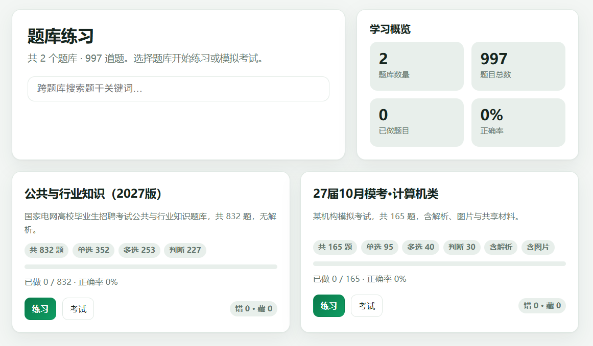

# 国家电网考试静态答题页面



纯静态、零前端依赖的答题网页，支持多个题库、练习 / 模拟考试、错题本、收藏、统计与解析。

**欢迎补充题库。** 你可以新增整套题库，也可以只补几道题、补充解析或修正错误，操作方法见下文。

当前内置两个题库：

| 题库 | 题量 | 说明 |
|---|---|---|
| 公共与行业知识（2027版） | 832 | 单选 352 / 多选 253 / 判断 227，无解析 |
| 27届10月模考·计算机类 | 165 | 含解析、图片、共享材料，按 0.5 / 1 分计分 |

## 快速开始

方式一：双击 `index.html`。

方式二（推荐）：

```bash
python -m http.server 8000
```

访问 <http://localhost:8000>。

进度保存在浏览器 `localStorage`（键 `sgcc.v1`），可在「设置 → 导出」备份。

## 功能

- 首页按题库分开展示，各自统计进度、错题、收藏。
- 练习模式：按章节 / 题型筛选、题量 10–全部、顺序或随机、即时判分、背题模式、断点续答。
- 考试模式：倒计时、答题卡、标记、交卷后统一判分、按题目分值合计得分。
- 解析：练习答完后显示；考试交卷后在成绩单中查看。
- 图片与共享材料：支持题干、选项、解析、资料分析材料中的图片。
- 错题本 / 收藏：按题库分组，可重练或清空本库。
- 跨题库搜索：结果标注所属题库，可直接进入单题练习。
- 统计：分题库进度与正确率、题型正确率、考试记录。
- 设置：深浅色主题、字号、选项乱序、答对自动下一题、数据导出 / 导入 / 重置。

### 快捷键

| 按键 | 作用 |
|---|---|
| `A`–`D` / `1`–`4` | 选择选项 |
| `Enter` | 提交 / 下一题 |
| `←` / `→` | 上一题 / 下一题 |
| `F` | 收藏 |
| `M` | 标记（考试） |

## 欢迎补充题库

贡献流程：

1. Fork 本仓库。
2. 按下面「添加题库」放入源文件并修改配置。
3. 运行构建，确认 `data/build_report.md` 校验通过。
4. 提交 PR，并简单说明题目来源。

请只提交你有权分享的题目，并保留来源说明。`data/` 和 `assets/` 下的文件由构建脚本生成，不要手动修改，改源文件和配置后重新构建即可。

### 添加一个题库

1. 新建目录 `sources/<题库ID>/`，放入源文件；图片放在同级 `images/` 下。
2. 在 `banks.config.json` 的 `banks` 数组里增加一条：

```json
{
  "id": "mock-2026-03",
  "name": "26届3月模考·计算机类",
  "shortName": "3月模考",
  "description": "某机构模拟考试，含解析。",
  "adapter": "structured_json_bank",
  "source": "sources/mock-2026-03/questions.json",
  "tags": ["模考"],
  "options": { "imageDir": "sources/mock-2026-03/images", "durationMin": 120 }
}
```

3. 安装依赖并构建：

```bash
pip install pypdf
python scripts/build_banks.py
```

4. 刷新网页即可，不需要修改 HTML 或 JavaScript。

### 支持的源文件类型

**PDF 题库**

适合「题号 + 选项 + 答案」连续排列的题库，例如：

```text
1、题干（ ）
A. 选项一
B. 选项二
C. 选项三
D. 选项四
答案：B
```

将 `adapter` 设为 `pdf_question_bank`，`source` 指向 PDF 文件。构建脚本读取 PDF 文本层，按题号、选项、答案解析。

**JSON 题库**

适合已有结构化数据的题库，可携带解析、图片、共享材料和分值。文件结构：

```json
{
  "paper": "题库名称",
  "sections": [
    {
      "title": "一、单选题（每题1分，共2题，总计2分）",
      "materials": [],
      "items": [
        {
          "seq": 1,
          "no": 1,
          "score": 1,
          "stem": "题干（ ）",
          "stem_images": [],
          "options": [
            { "key": "A", "text": "A. 选项一", "images": [] },
            { "key": "B", "text": "B. 选项二", "images": [] },
            { "key": "C", "text": "C. 选项三", "images": [] },
            { "key": "D", "text": "D. 选项四", "images": [] }
          ],
          "correct_answer": "B",
          "analysis": "解析内容，可留空。",
          "analysis_images": []
        }
      ]
    }
  ]
}
```

字段说明：

| 字段 | 说明 |
|---|---|
| `sections[].title` | 章节标题。包含「多选」按多选题处理，包含「判断」按判断题处理，其余按单选题；标题里的「每题 x 分」作为默认分值 |
| `sections[].materials` | 章节共享材料，资料分析题用。每项含 `text` 与 `images`，图片路径相对 JSON 文件 |
| `items[].seq` | 题库内唯一序号，作为题目标识，不能重复 |
| `items[].no` | 原始题号，仅用于展示，可重复 |
| `items[].score` | 本题分值，缺省使用章节默认分值 |
| `items[].stem` | 题干 |
| `items[].stem_images` | 题干图片，路径相对 JSON 文件 |
| `items[].options` | 选项。`text` 前的 `A.`/`A、` 会自动去掉 |
| `items[].correct_answer` | 正确答案。单选写 `A`，多选写 `BCD`，判断写 `A` 或 `B` |
| `items[].analysis` | 解析，可留空 |
| `items[].analysis_images` | 解析图片，路径相对 JSON 文件 |

将 `adapter` 设为 `structured_json_bank`，`source` 指向该 JSON 文件。

### 只补几道题或补充解析

- 已有 JSON 题库：直接在对应 `questions.json` 的 `items` 里增删题目、补充 `analysis`，然后重新构建。
- 已有 PDF 题库：PDF 不便直接增补时，可以新建一个小型 JSON 题库单独提交。
- 修正错题：修改源文件里的 `correct_answer` 或题干，重新构建后生效。

改完后都要运行一次：

```bash
python scripts/build_banks.py
```

并检查 `data/build_report.md`，确认题号、答案、选项校验没有警告。

### 扩展来源解析

如果题目在 Word、Excel、网页或其他格式里，可以在 `scripts/adapters.py` 里增加一个解析函数，把数据转换成下面的统一结构，然后注册到文件末尾的 `ADAPTERS` 字典中：

```python
def build_xxx(cfg, project_root, copier):
    # 读取源文件，返回统一题库结构
    ...
```

统一题库结构：

```text
bank = {
  id, name, shortName, description, tags,
  source: {type, file},
  exam: {durationMin, totalScore},
  sections: [{id, name, order, type, scorePer, count, materials[]}],
  questions: [{
    uid, bankId, localId, seq, no, type, sectionId, sectionName,
    stem, stemImages[], options[{key, text, images[]}], answer[],
    score, analysis, analysisImages[], warnings[]
  }]
}
```

`copier(图片路径)` 会把图片复制到 `assets/banks/<题库ID>/` 并返回网页可用路径。

构建脚本会自动完成：校验、统计、图片复制、生成题库清单与每个题库的数据文件。

## 文件结构

```text
SGCC_Exam/
  index.html
  styles.css
  app.js
  banks.config.json          题库注册表（添加题库改这里）
  scripts/
    build_banks.py           统一构建入口
    adapters.py              来源解析器
  sources/                   源文件（PDF / JSON / 图片）
  data/
    banks/manifest.js        题库清单（首页加载）
    banks/<id>.js            题库数据（按需加载）
    banks.json               合并数据（工具用）
    build_report.md          构建与校验报告
  assets/banks/<id>/         构建时复制的图片
  README.md
  LICENSE
```

## 双端互通（跨设备同步）

默认情况下进度、错题本、收藏保存在本机浏览器（localStorage），页面不联网。若想让手机和电脑共享同一份「进度 + 错题本 + 收藏」，在设置页开启「跨设备同步」并填写同步服务器地址即可。

- **同一 WiFi**：在电脑上双击 `启动SGCC题库-双端互通.bat`，手机浏览器打开 `http://电脑IP:8849/`（或电脑端自动打开的地址），两端自动同源同步。
- **任意网络（含手机流量）**：双击 `启动SGCC题库-公网版.bat`，脚本会建立 Cloudflare 快速隧道并给出 `https://xxxx.trycloudflare.com` 地址与二维码；把这个地址填进各设备的「同步服务器地址」即可跨网络同步。地址每次启动都会变化，且需要电脑保持开机。
- 同步范围：进度（已做/正确/错误）、错题本、收藏；「顺序练习做到第几题」仅存本机，不跨端。
- 冲突处理：服务器按版本号乐观锁，落后的一端会自动做并集合并，不会互相覆盖。

> 服务器端脚本建议自备（可参考 `tools/sgcc_sync_server.py` 的接口约定：`GET/POST /api/state`，body 含 `progress/wrong/fav/baseRev`）。在线版（GitHub Pages）本身是纯静态，只有在填写了同步服务器地址、且该服务可访问时才会同步，否则显示「离线·仅本机」。

## 说明

- 题库内容版权归原权利人所有，本项目仅用于个人学习与复习。
- 页面默认（未开启同步时）不发起任何网络请求。
